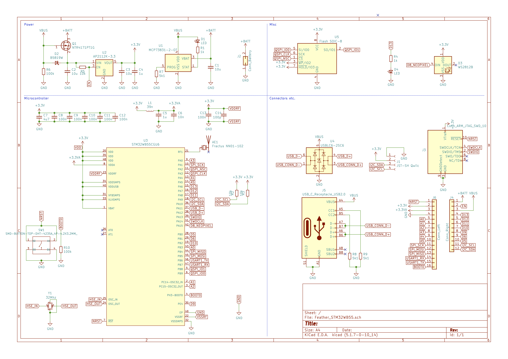
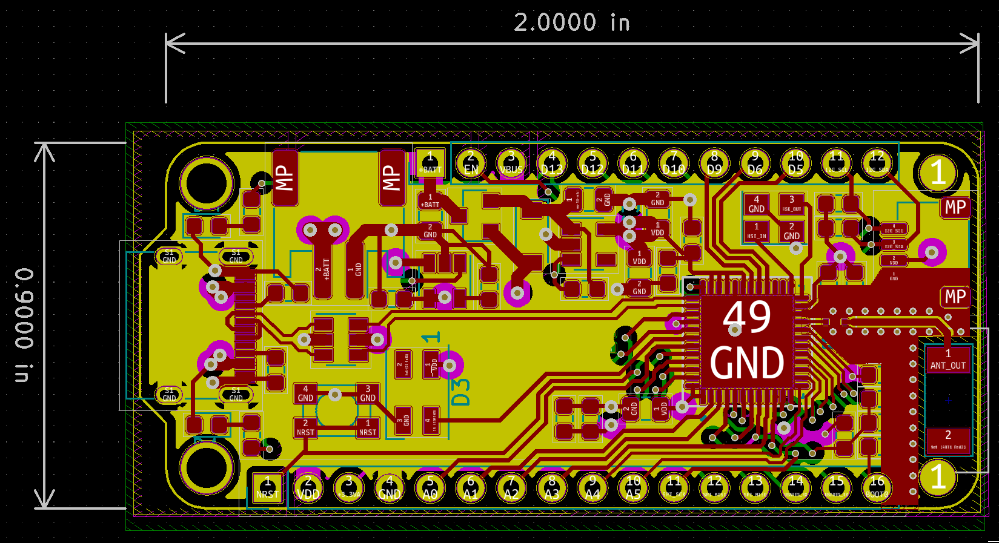
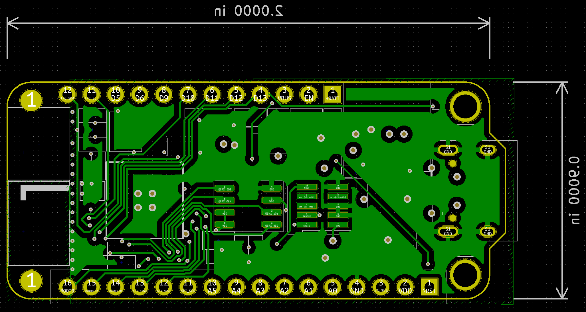
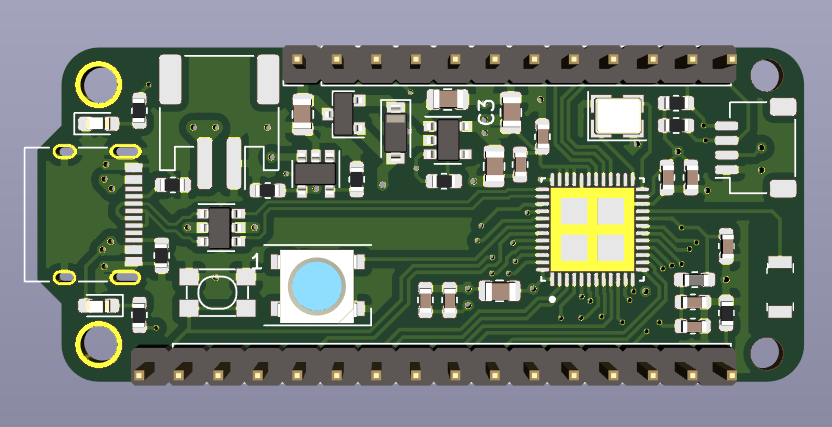
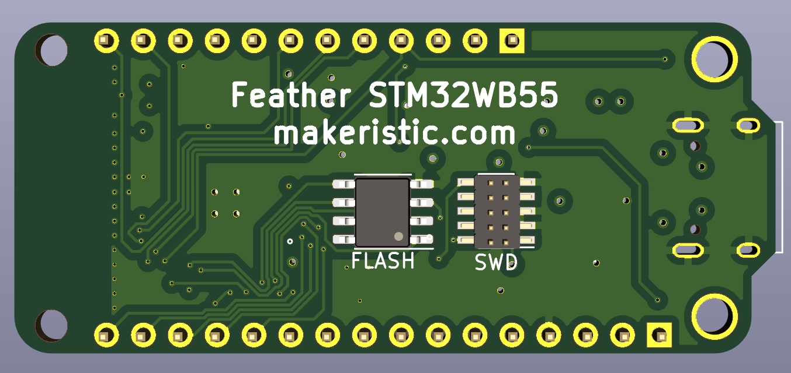

# Feather STM32WB55

A KiCad design for an STM32WB55CGU6 Bluetooth development board in the Adafruit Feather form factor, with USB-C, STEMMA QT, optional QSPI flash, and an optional SWD debug connector.

## WARNING: Work In Progress

This is a work in progress, it may not work at all.  :)

## Overview

I have several [Adafruit Feather](https://www.adafruit.com/category/943) boards, and Adafruit handily publish the [Feather Specification](https://learn.adafruit.com/adafruit-feather/feather-specification) here to make your own.  

I recently discovered the STM32WB series of microcontrollers which include Bluetooth connectivity and decided to build my own development board around it.  This repository is my first attempt at designing it and builds upon the great work of several sources (see Acknowledgements below).

The ultimate goal is to get this board working and running [CircuitPython](https://circuitpython.org/), once working I may do another revision with a focus on enabling more of the low power features of the STM32WB series.

## Features

* [STM32WB55CGU6](https://www.st.com/en/microcontrollers-microprocessors/stm32wb55cg.html) microcontroller
* Adafruit Feather compatible, with USB-C
* (Optional) QSPI-Dual flash module can be soldered to the back
* (Optional) ARM SWD 10-pin debug connector can be soldered on the back

## Notes

* The original fabrication notes specify a 4-layer board, 1mm thick with impedance-controlled traces, assuming the standard JLCPCB stackup. The committed PCB file currently records a thickness of 1.6mm; resolve this discrepancy with the board stackup before ordering.
* I've tried to standardise on 0.2mm tracks for signals, 0.3mm tracks for power.  VBUS and +BATT do have high-current tracks/pours to their respective pins to allow for powering things off-board like Neopixels.
* STMicroelectronics produce a custom matching network for this microcontroller [MLPF-WB55-01E3](https://www.st.com/en/emi-filtering-and-signal-conditioning/mlpf-wb55-01e3.html), the recommended PCB layout has been implemented here.
* The [Fractus Antenna](https://fractusantennas.com/compact-reach-xtend-nn01-102/) has a recommended layout which is implemented here.  The clearance area essentially takes up the entire tip of the board, though I have cheekily added the STEMMA QT connector, figuring it shouldn't have too big an impact.
* There is a lot of space around the center of the board, this is semi-intentional so I can extend the design with sensors, or an additional button.
* You can find my custom footprints etc. here [Makeristic-KiCad-Library](https://github.com/makeristic/Makeristic-KiCad-Library)

## Repository contents

* [KiCad project](Feather_STM32WB55.pro), [legacy schematic](Feather_STM32WB55.sch), [PCB](Feather_STM32WB55.kicad_pcb), and [netlist](Feather_STM32WB55.net).
* [Schematic PDF](Feather_STM32WB55-schematic.pdf) and [bill of materials](Feather_STM32WB55-BOM.csv).
* [Gerber and drill exports](gerber/), including both inner copper layers.
* [STM32CubeMX configuration](cubemx/cubemx.ioc). This is configuration input, not a complete firmware application or a CircuitPython port.
* [Vendor datasheets and layout references](datasheets/) and [design images](images/).

## Open or modify the design

1. Clone the repository and open `Feather_STM32WB55.pro` in KiCad. The PCB records KiCad **5.1.7**; the `.pro` and `.sch` files are legacy formats. Import into a copy if using a newer KiCad release.
2. Install the KiCad standard libraries and the linked Makeristic library. The schematic also references the external symbol/footprint library `IC_STMicroelectronics_STM32WB55CGU6`, which is not included here. There are no project library tables or schematic cache library in this checkout, so it is not a self-contained library setup.
3. Resolve symbol and footprint assignments before editing. Some 3D models use relative filenames, including `FR05-S1-N-0-102.stp` and `MLPF-WB55-01E3.stp`; locate the matching files in the Makeristic library and configure their paths locally.
4. Review the RF layout, power path, stackup, and design-rule results before fabrication. Treat the committed Gerbers as historical exports; this documentation update does not regenerate or validate them.

CircuitPython support remains the original project goal. No application firmware, flashing guide, or electrical/RF test report is included, and successful operation is not established by the files in this repository.

## Schematic

## PCB

## 3D Render

## TODO

* Improve the layout, potentially reassigning GPIO pins to simplify the traces

## Acknowledgements

* [Adafruit](https://www.adafruit.com/)
* [YouTube: Phil's Lab](https://www.youtube.com/c/PhilS94/videos)

## Feedback and related projects

Use [Issues](https://github.com/makeristic/Feather_STM32WB55/issues) for questions, build reports, missing-library information, or design corrections. Include the commit, KiCad version, and relevant component references. For design pull requests, explain the circuit change and identify any regenerated fabrication files.

Related projects: [Feather USB-C template](https://github.com/makeristic/Adafruit_Feather_USB-C), [STUSB4500 breakout](https://github.com/makeristic/STUSB4500_Breakout), and [Makeristic-KiCad-Library](https://github.com/makeristic/Makeristic-KiCad-Library).

## Licence

Michael Cutler's original design work and documentation are available under the [MIT licence](LICENSE). Vendor PDFs in `datasheets/`, third-party symbols, footprints and models (including embedded library elements), and third-party marks retain their respective owners' terms. The MIT grant does not relicense those materials or imply endorsement by the acknowledged organisations.
